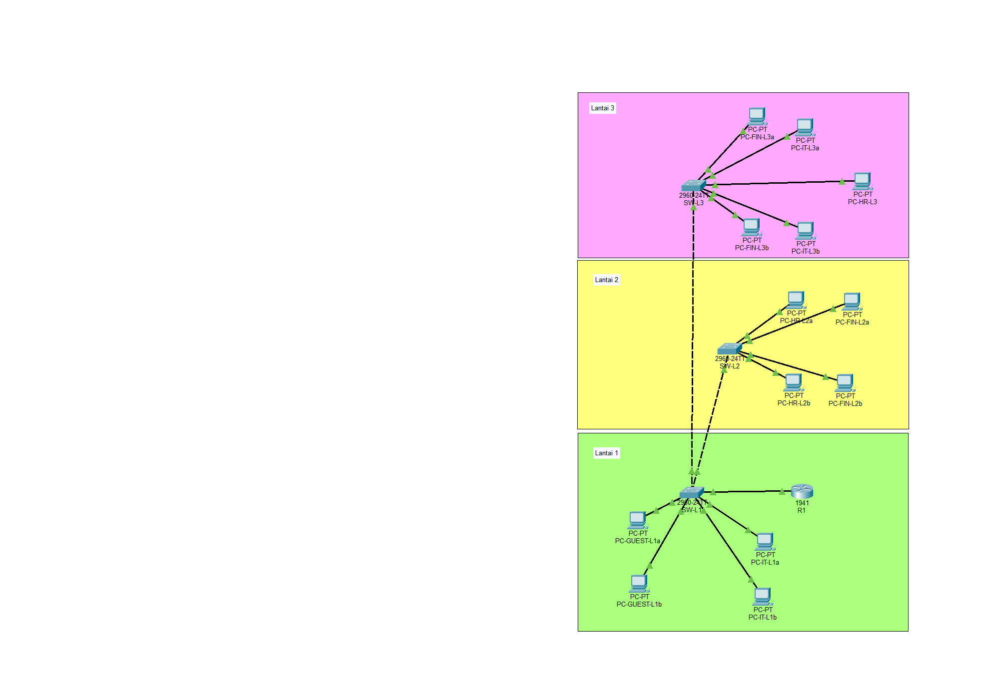

# Jaringan Kantor 3 Lantai dengan VLAN (Cisco Packet Tracer)

Simulasi jaringan kantor gedung 3 lantai di Cisco Packet Tracer. Departemen HR, IT, Finance, dan Guest dipisah ke VLAN masing-masing, tersebar di beberapa lantai, dan dihubungkan lewat trunk 802.1Q serta inter-VLAN routing (router-on-a-stick).

> **Summary (EN):** A 3-floor office network simulated in Cisco Packet Tracer. Four departments (HR, IT, Finance, Guest) are segmented into separate VLANs spanning multiple floors, connected through 802.1Q trunks between three Catalyst 2960 switches and a Cisco 1941 router performing inter-VLAN routing (router-on-a-stick). All intra-VLAN, cross-floor, and inter-VLAN connectivity tests passed.

---

## Tujuan

- Memisahkan jaringan per departemen menggunakan VLAN
- Menghubungkan VLAN yang sama di beberapa lantai lewat trunk antar-switch
- Menghubungkan antar-VLAN lewat router (router-on-a-stick)
- Memverifikasi konektivitas dalam satu lantai, antar lantai, dan antar-VLAN

## Skenario

Sebuah kantor menempati gedung 3 lantai dengan satu switch per lantai:

| Lantai | Switch                            | Jumlah PC | Departemen      |
| ------ | --------------------------------- | --------- | --------------- |
| 1      | SW-L1 (core, terhubung ke router) | 4         | IT, Guest       |
| 2      | SW-L2                             | 4         | HR, Finance     |
| 3      | SW-L3                             | 5         | Finance, IT, HR |

Total 13 PC. Setiap departemen memakai subnet sendiri, dan komunikasi antar-departemen dilewatkan melalui router.

## Topologi



## Perangkat

| Perangkat | Model                    | Jumlah                  |
| --------- | ------------------------ | ----------------------- |
| Router    | Cisco 1941               | 1 (R1)                  |
| Switch    | Cisco Catalyst 2960-24TT | 3 (SW-L1, SW-L2, SW-L3) |
| PC        | Generic PC               | 13                      |

## VLAN dan IP plan

| VLAN | Nama               | Network         | Gateway      |
| ---- | ------------------ | --------------- | ------------ |
| 10   | HR                 | 192.168.10.0/24 | 192.168.10.1 |
| 20   | IT                 | 192.168.20.0/24 | 192.168.20.1 |
| 30   | FINANCE            | 192.168.30.0/24 | 192.168.30.1 |
| 40   | GUEST              | 192.168.40.0/24 | 192.168.40.1 |
| 99   | MGMT (native VLAN) | 192.168.99.0/24 | 192.168.99.1 |

Alamat management switch: SW-L1 `192.168.99.2`, SW-L2 `192.168.99.3`, SW-L3 `192.168.99.4`.

Tabel lengkap (13 PC, port switch, kabel, dan trunk) ada di [`docs/ip-plan.md`](docs/ip-plan.md).

## Konfigurasi kunci

Konfigurasi penuh hasil `show running-config` tersimpan di folder [`configs/`](configs/): [`R1.txt`](configs/R1.txt), [`SW-L1.txt`](configs/SW-L1.txt), [`SW-L2.txt`](configs/SW-L2.txt), [`SW-L3.txt`](configs/SW-L3.txt).

**Trunk dan management di switch (contoh SW-L1)**

```
interface range gi0/1, fa0/23-24
 switchport mode trunk
 switchport trunk native vlan 99
 switchport trunk allowed vlan 10,20,30,40,99
!
interface vlan 99
 ip address 192.168.99.2 255.255.255.0
 no shutdown
!
ip default-gateway 192.168.99.1
```

**Inter-VLAN routing di R1 (router-on-a-stick)**

```
interface g0/0
 no shutdown
!
interface g0/0.10
 encapsulation dot1Q 10
 ip address 192.168.10.1 255.255.255.0
interface g0/0.20
 encapsulation dot1Q 20
 ip address 192.168.20.1 255.255.255.0
interface g0/0.30
 encapsulation dot1Q 30
 ip address 192.168.30.1 255.255.255.0
interface g0/0.40
 encapsulation dot1Q 40
 ip address 192.168.40.1 255.255.255.0
interface g0/0.99
 encapsulation dot1Q 99 native
 ip address 192.168.99.1 255.255.255.0
```

## Verifikasi

Perintah yang dipakai untuk memeriksa konfigurasi:

| Perintah                  | Perangkat           | Bukti                                                                                                                                       |
| ------------------------- | ------------------- | ------------------------------------------------------------------------------------------------------------------------------------------- |
| `show vlan brief`         | SW-L1, SW-L2, SW-L3 | [SW-L1](images/verifikasi/01-vlan-SW-L1.png), [SW-L2](images/verifikasi/01-vlan-SW-L2.png), [SW-L3](images/verifikasi/01-vlan-SW-L3.png)    |
| `show interfaces trunk`   | SW-L1, SW-L2, SW-L3 | [SW-L1](images/verifikasi/02-trunk-SW-L1.png), [SW-L2](images/verifikasi/02-trunk-SW-L2.png), [SW-L3](images/verifikasi/02-trunk-SW-L3.png) |
| `show ip interface brief` | R1                  | [R1](images/verifikasi/03-ip-interface-R1.png)                                                                                              |
| `show ip route`           | R1                  | [R1](images/verifikasi/04-route-R1.png)                                                                                                     |

## Hasil uji konektivitas

| ID  | Skenario                             | Perintah                           | Hasil                      |
| --- | ------------------------------------ | ---------------------------------- | -------------------------- |
| T1  | Satu VLAN, satu switch               | PC-HR-L2a `ping 192.168.10.12`     | Berhasil                   |
| T2  | PC ke gateway                        | PC-HR-L2a `ping 192.168.10.1`      | Berhasil                   |
| T3  | Satu VLAN, beda lantai (lewat trunk) | PC-HR-L2a `ping 192.168.10.13`     | Berhasil                   |
| T4  | Finance Lantai 2 ke Lantai 3         | PC-FIN-L2a `ping 192.168.30.13`    | Berhasil                   |
| T5  | IT Lantai 1 ke Lantai 3              | PC-IT-L1a `ping 192.168.20.13`     | Berhasil                   |
| T6  | Antar-VLAN (lewat R1)                | PC-HR-L2a `ping 192.168.20.11`     | Berhasil                   |
| T7  | Guest ke Finance (belum ada ACL)     | PC-GUEST-L1a `ping 192.168.30.13`  | Berhasil                   |
| T8  | Jalur antar-VLAN                     | PC-HR-L3 `tracert 192.168.30.11`   | Hop pertama `192.168.10.1` |
| T9  | Management switch dari router        | R1 `ping 192.168.99.2`, `.3`, `.4` | Berhasil                   |

Bukti screenshot ada di folder [`images/uji-ping/`](images/uji-ping/).

T7 berhasil karena pada project ini belum ada pembatasan akses. ACL ditambahkan di project lanjutan (lihat bagian Rencana Lanjutan).

## Hasil dan pembelajaran

- VLAN harus dibuat di **setiap switch**. VLAN yang ada di satu switch tidak otomatis ada di switch lain.
- Daftar `allowed vlan` di trunk menentukan VLAN mana yang bisa lewat antar-switch. VLAN yang tidak diizinkan akan terputus di lantai itu.
- Native VLAN harus sama di kedua ujung trunk.
- Pada router-on-a-stick, satu port fisik dibagi menjadi beberapa subinterface, satu per VLAN, dengan `encapsulation dot1Q`.
- Komunikasi dalam satu VLAN tidak melewati router, sedangkan antar-VLAN selalu melewati gateway (terlihat di `tracert`).

## Cara membuka

1. Install Cisco Packet Tracer (versi yang dipakai: `[isi versi, lihat menu Help > About]`).
2. Buka file [`pkt/vlan-3lantai-final.pkt`](pkt/vlan-3lantai-final.pkt).
3. Klik perangkat dan buka tab **CLI** untuk melihat konfigurasi, atau buka **Desktop > Command Prompt** di PC untuk menjalankan uji ping.

## Struktur repo

```
packet-tracer-vlan-3-lantai/
├── README.md
├── pkt/
│   └── vlan-3lantai-final.pkt
├── configs/
│   ├── R1.txt
│   ├── SW-L1.txt
│   ├── SW-L2.txt
│   └── SW-L3.txt
├── docs/
│   └── ip-plan.md
└── images/
    ├── topologi.png
    ├── verifikasi/
    └── uji-ping/
```

## Keyword

VLAN, 802.1Q trunking, inter-VLAN routing, router-on-a-stick, subinterface, native VLAN, IP addressing, subnetting, network segmentation, Cisco IOS CLI, Cisco Packet Tracer

## Rencana lanjutan

Topologi ini menjadi dasar **Project 2**, yang menambahkan:

- DHCP relay (`ip helper-address`) agar PC mendapat IP otomatis
- ACL untuk membatasi akses antar-departemen (misalnya Guest hanya boleh ke internet)
- NAT/PAT ke jaringan "internet"
- Hardening (SSH, port security, shutdown port tidak terpakai)
- Skenario troubleshooting (gejala, diagnosa, dan perbaikan)

## Penulis

Moch Hasbi Ashidqy
